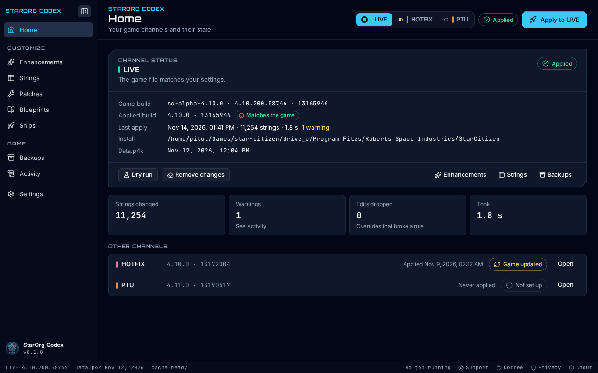
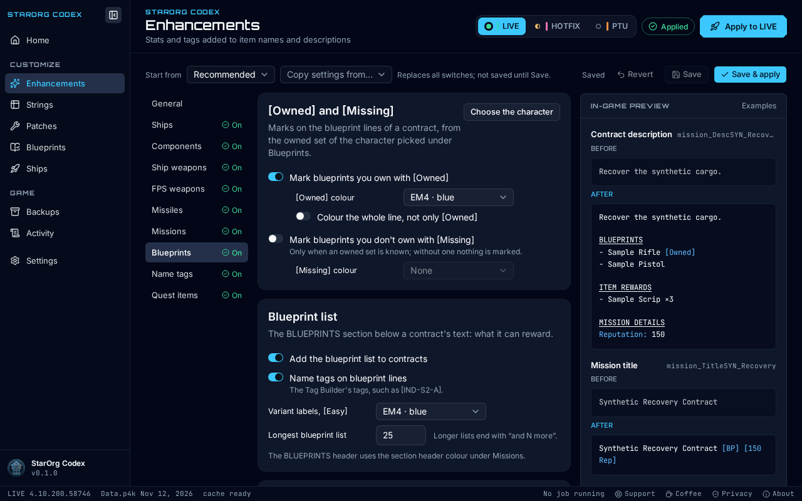
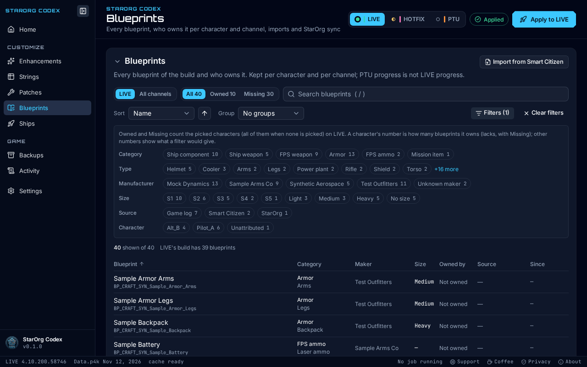
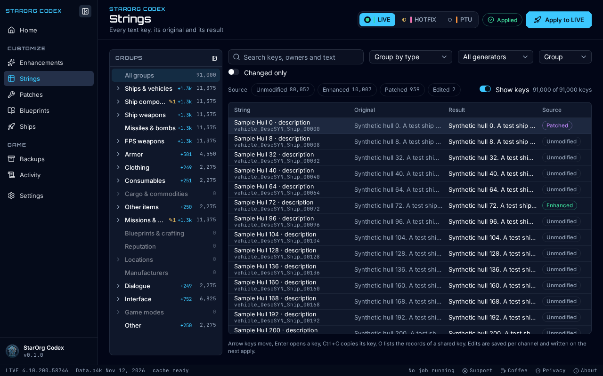
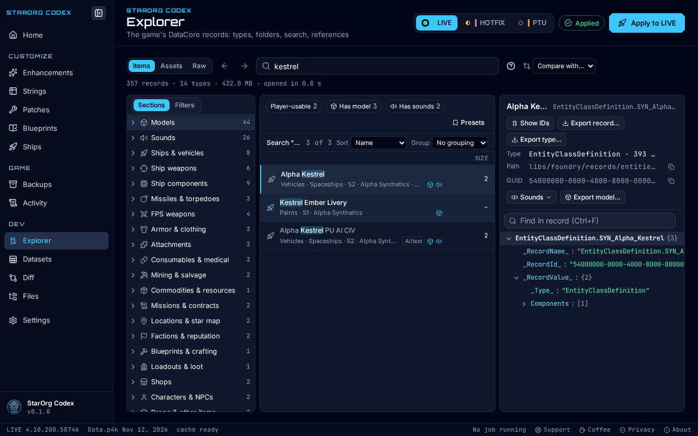

# StarOrg Codex

Clearer Star Citizen item, ship and mission text, built from the files of your own install and
removable in one click. StarOrg Codex writes a new game text file (`global.ini`): component names
get short tags such as size, class and grade, ship and weapon descriptions get a stats block,
contracts show what they reward and whether you already own those blueprints, and quest items say
what they are for. You choose what is added and preview every change before it is written. A
desktop app for Windows and Linux, plus the `starorg-codex` command-line tool.

> [!NOTE]
> StarOrg Codex is based on the work of the Star Citizen localization community:
> [StarStrings](https://github.com/MrKraken/StarStrings) by MrKraken,
> [Smart Citizen](https://github.com/Osiris-DevWorks/smart-citizen) by Osiris DevWorks and the
> [Component Language Pack](https://github.com/ExoAE/ScCompLangPack) by ExoAE. See
> [Credits](#credits).

| | |
|---|---|
|  |  |
|  |  |

<sub>Rendered from the app's mock data (synthetic items, paths and characters).</sub>

## Features

**In game**
- Component tags (`[IND-S2-A]`: class, size, grade) and stats blocks for ships, components,
  ship weapons, personal weapons and missiles
- Mission info in contracts: rewards, details, reputation and `[BP]` / `[BP Owned]` title tags
- Blueprint lists in contracts with **[Owned]** / **[Missing]** markers for your character, in
  colours you choose
- Quest item hints ("Used in: contract · system") and hand-written notes, starting with
  Vanduul-Tech Smugglers (Nyx)
- Fixes for known text bugs, plus your own edits and patch packs; the Strings browser shows
  every text key with what it belongs to
- Your ships in your order and with your names in game ship lists (Ships, from a fleet import)
- LIVE, PTU, EPTU, HOTFIX and other channels; preview, automatic backups and one-click Remove;
  on Linux, LUG Helper launch hooks re-apply after every game patch

**Blueprints**
- Finder: every blueprint of the build and who owns it, per character and channel
- Ownership from your `Game.log`, Smart Citizen's tracker export, or StarOrg Tools sync
  (optional); re-scan and re-import after a character reset

**Developer tools** (Settings -> Advanced -> Developer mode)
- Explorer item finder over the game's records: sections, search, filters, compare, sounds
  and model export (GLB, STL)
- Datasets and Diff with group trees, and a `Data.p4k` file browser
- A local MCP server for Claude Code / Claude Desktop (experimental, off by default)



**Privacy**
- No account, no telemetry. With the default settings the app makes no network request; the
  update check and StarOrg Tools are opt-in ([what each sends](docs/privacy.md))
- Never writes while the game or a launcher update is running

## System requirements

A Star Citizen install (on Linux: in a Wine prefix) and a 64-bit x86 PC (x64 / x86_64).

| Install type | OS | Needs | Notes |
|---|---|---|---|
| Windows installer (`.exe`, `.msi`) | Windows 10 1809+ or 11 | Microsoft Edge WebView2 runtime | Built into Windows 11 and updated Windows 10; the `.exe` downloads it if missing |
| Windows CLI zip | Windows 10 or 11 | Microsoft Visual C++ Redistributable (`VCRUNTIME140.dll`) | Most PCs already have it; the app does not need it |
| Linux AppImage | Any distro with glibc 2.35+, Steam Deck | A `fusermount3` or `fusermount` program (package `fuse3` on most distros) | No libfuse2 needed. Without FUSE: `--appimage-extract-and-run` |
| Linux `.deb` | Debian 12, Ubuntu 22.04 or newer | `libwebkit2gtk-4.1-0`, `libgtk-3-0` | apt installs them, plus `gstreamer1.0-plugins-good` (recommended) |
| Linux `.rpm` | Fedora, openSUSE, Nobara | WebKitGTK 4.1 (`webkit2gtk4.1`, openSUSE `libwebkit2gtk-4_1-0`) | Recommends `gstreamer1-plugins-good` (Fedora) or `gstreamer-plugins-good` (openSUSE) |
| Linux CLI tarball | Any x86_64 Linux | Nothing (static binary) | |

Developer mode (optional) needs a little more:

- **Sounds on Linux:** the GStreamer "good" plugins (Arch/CachyOS `gst-plugins-good`,
  Debian/Ubuntu `gstreamer1.0-plugins-good`, Fedora `gstreamer1-plugins-good`, openSUSE
  `gstreamer-plugins-good`) with the .deb, .rpm or a source build. In the
  AppImage, sound playback does not work on most distros: it bundles an old GStreamer core
  (1.20) but no plugins, and cannot load the system's. Exporting a sound works everywhere.
- **3D model viewer:** WebGL 2 in the webview, so a working GPU driver with hardware
  acceleration. On some older WebKitGTK builds, `--safe-gpu` can turn WebGL off; "Export .glb"
  still works.
- **Memory and disk:** big datasets need several GB of RAM (Settings -> Advanced -> Memory
  limit); the asset cache uses up to 2 GB by default.

More detail: [Windows](docs/windows.md#requirements), [Linux](docs/linux.md#requirements).

## Install

Downloads are on the [releases page](https://github.com/voidput/starorg-codex/releases). Every
file is listed in `SHA256SUMS`; the installers and CLI archives also carry a build provenance
attestation (`gh attestation verify <file> -R voidput/starorg-codex`).

**Windows 10/11:** run `StarOrg.Codex_<version>_x64-setup.exe` (per user, no admin rights). The
`.msi` and a portable CLI zip are there too; a Microsoft Store version is planned. Details,
SmartScreen and signing: [docs/windows.md](docs/windows.md).

**Linux:** the AppImage (any distro, Steam Deck), the `.deb` (Debian, Ubuntu, Mint) or the `.rpm`
(Fedora, openSUSE). Or the installer script, which puts the CLI (and with `--app` the AppImage
and a menu entry) in `~/.local/bin` without sudo:

```sh
curl -fsSL https://raw.githubusercontent.com/voidput/starorg-codex/main/scripts/install-linux.sh | sh -s -- --app
```

Wine prefix, launch hooks and troubleshooting: [docs/linux.md](docs/linux.md).

**Command line** (both systems; shares settings and backups with the app):

```sh
starorg-codex channels                                # what was found
starorg-codex setup --channel LIVE --preset recommended --yes   # --yes = consent to write there
starorg-codex apply --channel LIVE --dry-run          # check, writes nothing
starorg-codex apply --channel LIVE
starorg-codex remove --all                            # back to stock
```

Then start the game (it reads the text only at start). After a game patch, apply again; on
Linux the LUG Helper launch hooks do it for you.

### Upgrading from 0.2

0.3.0 renamed everything from `starorg-strings` to `starorg-codex` (CLI, app binary, release
files, app folders). The folders move by themselves on the first start; quit the old app first.

- **Windows:** the new installer upgrades 0.2 in place. To start clean instead, uninstall 0.2
  under Settings -> Apps first; your settings and backups stay and move on the first start.
  The CLI zip keeps a `starorg-strings.exe` copy for this release only.
- **Linux:** the packages replace `starorg-strings-app`; the CLI keeps a `starorg-strings` link
  for this release only. Launch hooks written by 0.2 show as *Outdated*: install them again
  (Settings -> Launch hooks, or `starorg-codex hook install --bin ~/.local/bin/starorg-codex`).

Details: [Linux](docs/linux.md#upgrading-from-02-the-rename-to-starorg-codex) ·
[Windows](docs/windows.md#upgrading-from-02-the-rename).

## Documentation

- [User guide](docs/user-guide.md): first run, applying, enhancements and markers, blueprints,
  patches, backups, CLI quick reference, troubleshooting
- [Linux](docs/linux.md) · [Windows](docs/windows.md) · [Updates](docs/updates.md) ·
  [Privacy](docs/privacy.md) · [Local MCP server](docs/mcp.md)
- [Uninstall](docs/uninstall.md): back to stock first, then remove the app and, if you want, its data
- Everything else (specs, decisions, release process): [docs/](docs/README.md)

## Support

- Questions, bugs and ideas: the [Discord server](https://discord.gg/GCkYhbFYNq), or open an
  [issue](https://github.com/voidput/starorg-codex/issues). Attach the diagnostics report
  (Activity -> Diagnostics).
- If the app saves you time: [Buy me a coffee](https://buymeacoffee.com/zedwil) or support
  StarOrg Tools on [Patreon](https://www.patreon.com/cw/StarOrgTools).

These links are also in the app (footer and Footer -> About); they open your browser.

## Development

Rust workspace (`crates/`) plus the Tauri 2 + Svelte 5 app (`app/`). See
[CONTRIBUTING.md](CONTRIBUTING.md) for the checks and commit rules, [AGENTS.md](AGENTS.md) for the
repo map and rules (also for AI agents), [PATCH.md](PATCH.md) for text patches and pull requests, [app/README.md](app/README.md)
for the app, and [docs/](docs/README.md) for specs, decisions and the release process. Security
issues: [SECURITY.md](SECURITY.md).

## Credits

StarOrg Codex builds on these projects; thank you to their authors.

- [StarStrings](https://github.com/MrKraken/StarStrings) by MrKraken: the string replacement
  quality-of-life pack (contract `[BP]` tags, commodity and hauling text clean-ups and more).
- [Smart Citizen](https://github.com/Osiris-DevWorks/smart-citizen) by Osiris DevWorks: the
  UI-based localization editor and enhancer that many of the app's features follow, and the
  blueprint tracker export Codex imports.
- [ScCompLangPack](https://github.com/ExoAE/ScCompLangPack) by ExoAE: the component language
  pack (component names with class and grade for spotting and tracking stats).
- [StarBreaker](https://github.com/diogotr7/StarBreaker): the `Data.p4k`, DataCore and model
  export crates behind the Developer tools.

## License

MIT, see [LICENSE](LICENSE). Third-party software included in the builds, with its licenses:
[THIRD_PARTY_NOTICES.md](THIRD_PARTY_NOTICES.md) (regenerate with `scripts/gen-notices.sh`). The
same notices are in the app under Footer -> About and in every release.

## Disclaimer

StarOrg Codex is an unofficial Star Citizen fan project, not affiliated with the Cloud Imperium
group of companies. All content in this app not authored by its host or users are property of
their respective owners. Star Citizen®, Roberts Space Industries® and Cloud Imperium® are
registered trademarks of Cloud Imperium Rights LLC.

StarOrg Codex ships no game assets. It reads the game files of your own installation and writes
only your own local files (the game text file, one line in `USER.cfg`, and its own settings,
backups and cache). Anything you export in Developer mode is Cloud Imperium's: for your own use,
not to redistribute.
